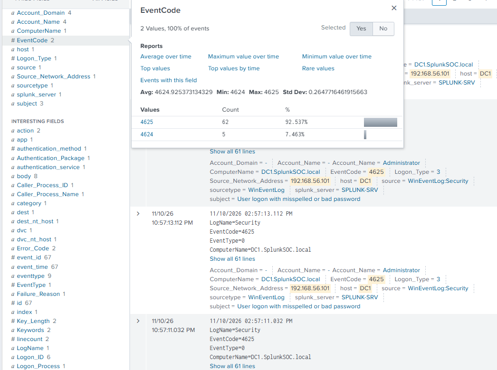
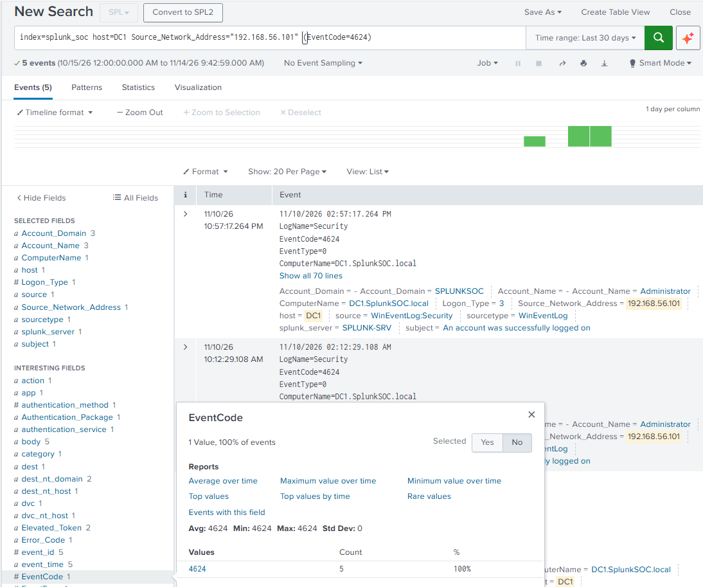
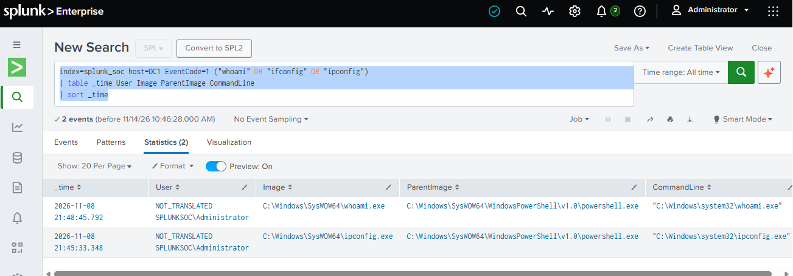
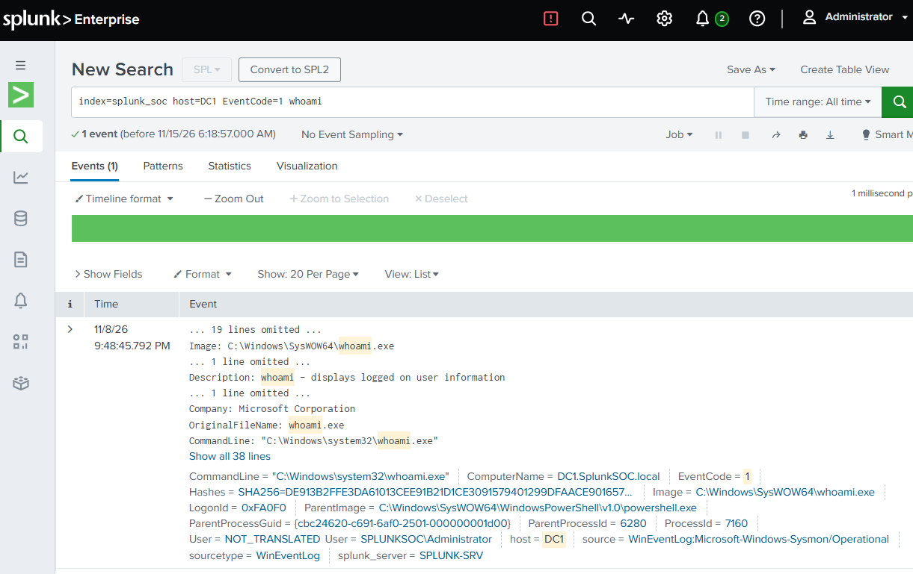
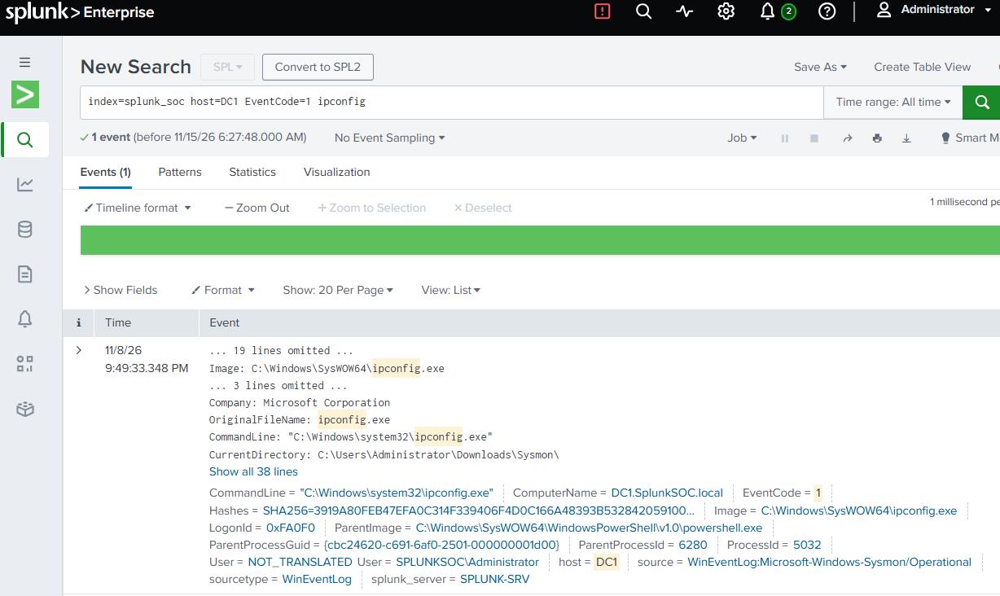
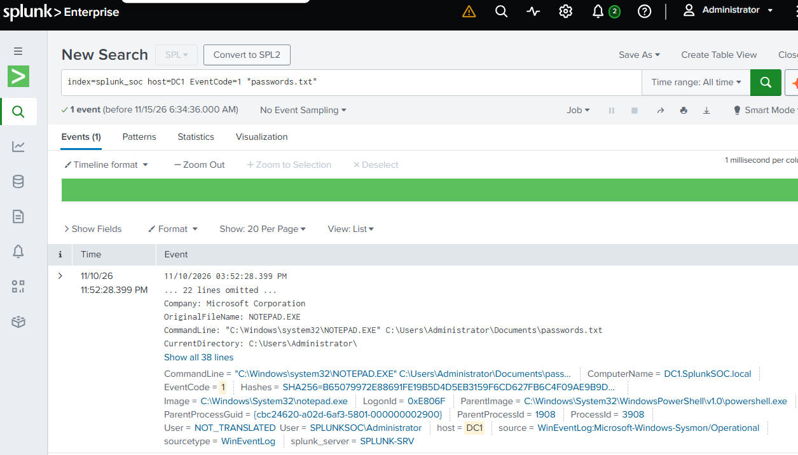

# I-10 · SIEM Investigation of Escalated Alerts

## Investigation Details

| Field | Value |
|---|---|
| **Date of Report** | 15 November 2026 |
| **Reported By** | SOC Analyst |
| **Security Level** | High |
| **Report Status** | Investigation completed; confirmed malicious activity |
| **Escalated To** | SOC Lead |

## 1. Executive Summary

- **Incident Overview:** Investigated escalated alerts involving repeated network logon attempts against DC1 and Mythic command-and-control activity.
- **Impact:** Confirmed successful Administrator logons from Kali, Apollo payload execution, system-discovery activity, HTTP-based C2 communications and file exfiltration.
- **Risk:** Compromise of a privileged account on the domain controller, with potential exposure of sensitive information.
- **Status:** Investigation completed; suspicious persistence and lateral movement were not confirmed in the reviewed telemetry.
- **Required Action:** Review the Administrator account, preserve evidence, investigate the attack infrastructure and implement appropriate containment and credential-reset measures.

## 2. Findings

### Initial Access — Valid Accounts

- DC1 recorded 62 failed network logons (Event ID 4625) from Kali (`192.168.56.101`).
- 60 attempts targeted Administrator; 2 targeted root.
- Three successful Administrator network logons (Event ID 4624) were also recorded using NTLMv2.
- Successful sessions occurred on 7 November and 10 November 2026.
- Logon IDs correlated successful sessions with privilege-assignment (Event ID 4672) and logoff (Event ID 4634) events.

**Assessment:** Confirmed repeated authentication failures and successful Administrator network logons from Kali.

### Confirmed Privileged-Account Compromise and Post-Authentication Activity

- PowerShell (PID 6280) launched `apollo-payload.exe` (PID 2336) on 8 November 2026 at 21:18:38.
- Apollo spawned `conhost.exe` (PID 6948).
- The Apollo payload executed under the Administrator account.

**Assessment:** Confirmed privileged-account activity and Apollo payload execution on DC1.

### Persistence

- Reviewed seven Windows service-installation events (Event ID 7045).
- Identified LimaCharlie, Windows Defender driver components and Sysmon services.
- No suspicious Mythic-related service installation was identified.

**Assessment:** No suspicious persistence mechanism confirmed in the reviewed events.

### Hands-on Post-Authentication Activity Observed

- **Discovery:** Sysmon recorded `whoami.exe` at 21:48:45 and `ipconfig.exe` at 21:49:33 under `SPLUNKSOC\Administrator`.
- **Command and Control:** Sysmon Event ID 3 recorded outbound TCP connections from DC1 to Mythic (`192.168.56.111`) over port 80.
- **Lateral Movement:** Reviewed 2,445 successful logon events; no confirmed attacker-originated lateral movement was identified.
- **Data Exfiltration:** Mythic Apollo's `download` command retrieved `passwords.txt` from DC1; Mythic recorded the 167-byte file as artifact Task T-3.
- **Additional Evidence:** Windows telemetry recorded PowerShell launching Notepad to open `passwords.txt` on 10 November at 23:52:28.

**Assessment:** Confirmed endpoint discovery, Mythic C2 communications and file retrieval; no confirmed lateral movement or suspicious persistence was identified.

## 3. Investigation Timeline

| Timestamp (as recorded) | Event |
|---|---|
| 7 Nov 2026, 16:35:38 | First observed failed Administrator/root network logon attempt from Kali. |
| 7 Nov 2026, 16:36:19 | Successful Administrator network logon from Kali. |
| 8 Nov 2026, 21:18:38 | PowerShell launched `apollo-payload.exe` on DC1. |
| 8 Nov 2026, 21:18:40 | Apollo initiated an outbound connection to Mythic C2 over TCP/80. |
| 8 Nov 2026, 21:48:45 | Apollo activity resulted in execution of `whoami.exe` under `SPLUNKSOC\Administrator`; the recorded parent process was PowerShell. |
| 8 Nov 2026, 21:49:33 | Apollo activity resulted in execution of `ipconfig.exe` under `SPLUNKSOC\Administrator`. |
| 10 Nov 2026, 10:12:29 | Second successful Administrator network logon from Kali. |
| 10 Nov 2026, 22:57:15 | Latest observed failed network logon from Kali. |
| 10 Nov 2026, 22:57:17 | Third successful Administrator network logon from Kali. |
| 10 Nov 2026, 23:52:28 | Notepad opened the `passwords.txt` test file on DC1. |

## 4. Who, What, When, Where, Why, How

| Question | Investigation Detail |
|---|---|
| **Who** | Activity originated from Kali |
| **What** | Compromise of the Administrator account and exfiltration of passwords.txt on DC1 |
| **When** | 7–10 November 2026, based on the recorded SIEM event timestamps. |
| **Where** | Domain controller DC1, the affected system under investigation. |
| **Why** | To retrieve sensitive credential file (passwords.txt) |
| **How** | Through repeated network logon attempts, endpoint discovery, PowerShell-based Apollo execution and Mythic C2 establishment. |

## 5. MITRE ATT&CK Techniques

| Tactic | Technique |
|---|---|
| **Initial Access** | T1078 – Valid Accounts |
| **Execution** | T1059.001 – PowerShell |
| **Discovery** | T1033 – System Owner/User Discovery |
| **Discovery** | T1016 – System Network Configuration Discovery |
| **Command and Control** | T1071.001 – Web Protocols |
| **Exfiltration** | T1041 – Exfiltration Over C2 Channel |

## 6. Recommendations & Next Steps

**Immediate Containment and Evidence Preservation**
- Review and secure the Administrator account.
- Preserve relevant Windows Security, Sysmon and network telemetry.
- Investigate the source and scope of the successful Administrator sessions.

**Persistence Review**
- Continue monitoring service-installation and registry activity.
- Investigate any newly identified suspicious persistence indicators.

**Scoping**
- Review additional authentication and process activity involving DC1.
- Assess other systems for connections to the identified attacker infrastructure.
- Continue monitoring for further C2 communications.

**Hardening and Preventive Controls**
- Enforce strong privileged-account authentication controls.
- Restrict RDP access to authorized management systems.
- Review PowerShell execution controls and endpoint monitoring.
- Improve detection for repeated authentication failures followed by successful privileged logons.

## 7. Indicators of Compromise (IOCs)

| Type | Value |
|---|---|
| **IP addresses** | `192.168.56.101` (Kali), `192.168.56.111` (Mythic Server) |
| **User accounts** | `Administrator`; `root` |
| **Hostnames** | `DC1` (`192.168.56.110`) |
| **File names / paths** | `apollo-payload.exe, passwords.txt` |
| **Domains / URLs** | `None identified` |
| **Processes / services** | `powershell.exe` (PID 6280); `apollo-payload.exe` (PID 2336); `conhost.exe` (PID 6948) |
| **Other indicators** | `TCP/80`, `Apollo Process GUID` {cbc24620-e72e-6af0-6c05-000000001d00},  `Mythic artifact Task T-3` (167 bytes) |

## 8. Appendix

**Evidence Sources**
- Splunk Windows Security Event ID 4625 — failed logons.
- Splunk Windows Security Event ID 4624 — successful logons.
- Splunk Windows Security Event ID 4672 — special privilege assignment.
- Splunk Windows Security Event ID 4634 — logoff events.
- Splunk Sysmon Event ID 1 — process creation.
- Splunk Sysmon Event ID 3 — network connections.
- Windows Security Event ID 4688 — process creation corroboration.
- Windows System Event ID 7045 — service installation.
- Mythic Apollo Task T-3 — retrieved 167-byte file artifact.

## Evidence

### Failed Logons — Event ID 4625

Splunk confirms repeated failed network logons against DC1 originating from the attacker host.

### Successful Logons — Event ID 4624

Splunk confirms successful Administrator network logons from the attacker host to DC1.

### Apollo Payload Execution

Sysmon Event ID 1 confirms Apollo payload execution on DC1, launched by PowerShell under the Administrator account.

### System Identity Discovery — whoami.exe

Sysmon Event ID 1 confirms `whoami.exe` execution on DC1 under the Administrator account, with PowerShell recorded as its parent process.

### Network Configuration Discovery — ipconfig.exe

Sysmon Event ID 1 confirms `ipconfig.exe` execution on DC1 under the Administrator account, spawned by the Apollo process.

### File Exfiltration — passwords.txt

Mythic Apollo Task T-3 records retrieval of the 167-byte `passwords.txt` file, confirming unauthorized data exfiltration.

## Operational Impact

The incident demonstrated how compromised privileged access could expose sensitive information, enable unauthorized system activity, and threaten the confidentiality and integrity of business systems.